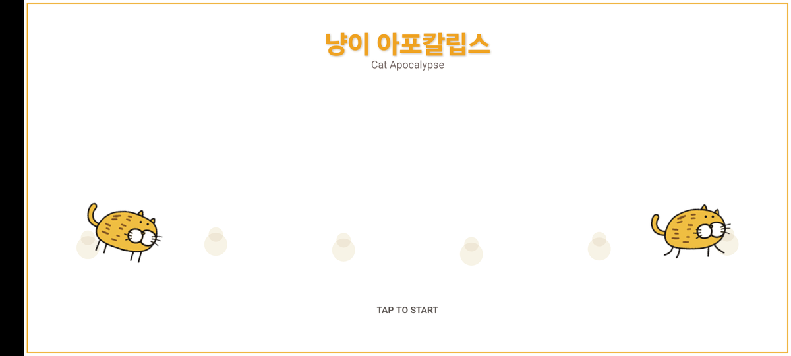
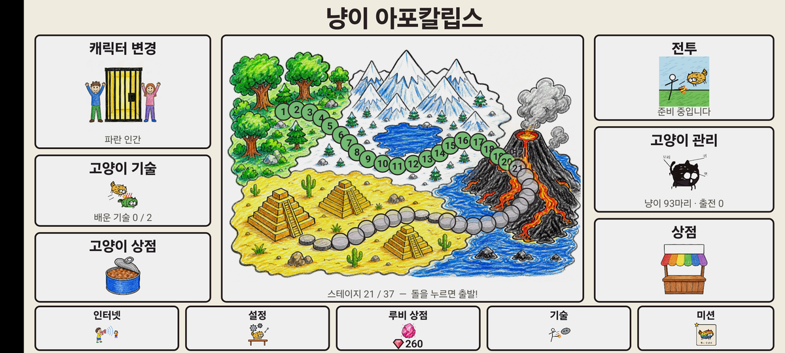
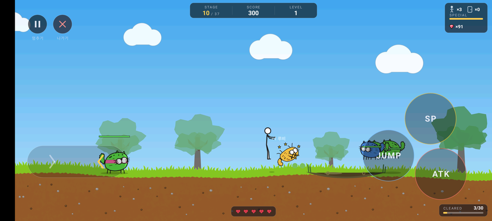
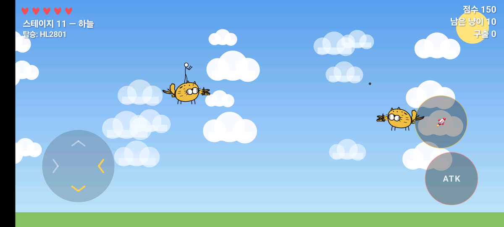
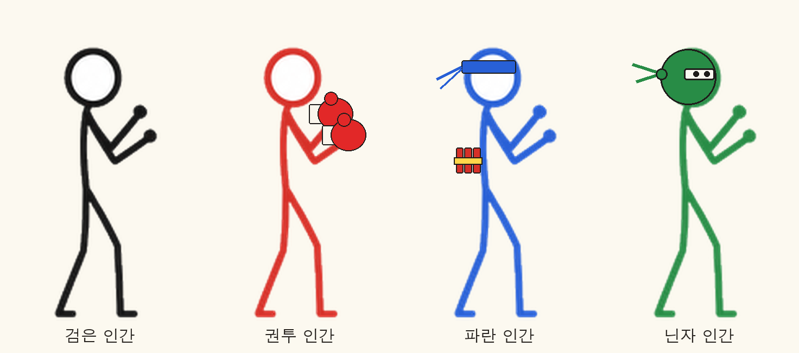
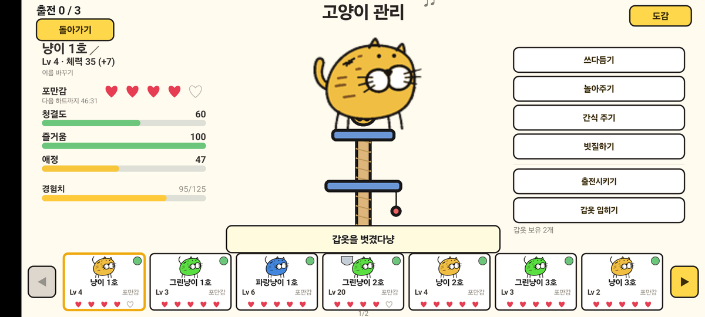
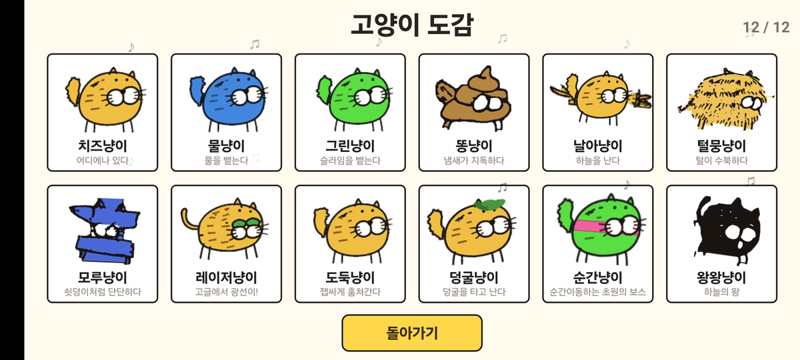
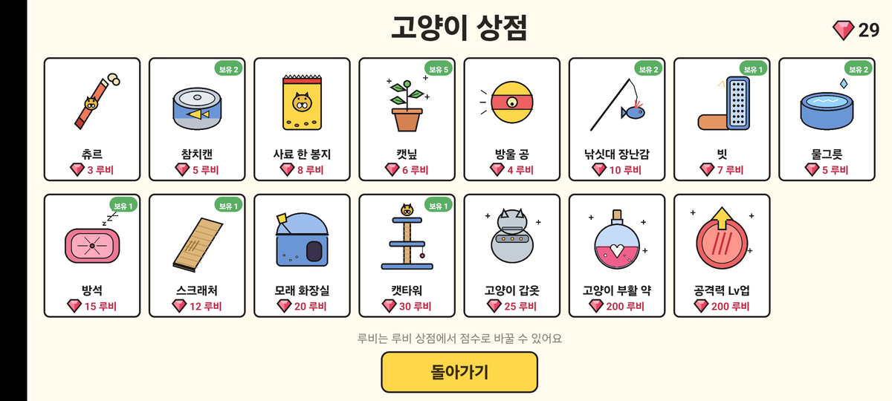
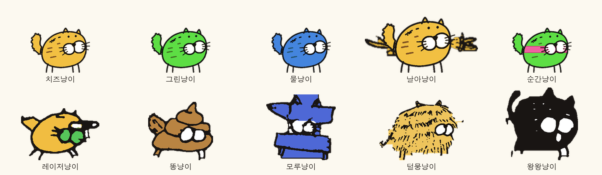

# 냥이 아포칼립스 (Cat Apocalypse)



고양이들이 세상을 차지해 버린 뒤, 인간이 감옥에 갇힌 사람들과 착한 냥이들을 구해 내는 **안드로이드 횡스크롤 액션 게임**입니다.
기획과 캐릭터 원안은 손그림으로 그렸고(`Plan/`), 게임은 Kotlin + SurfaceView/Canvas로 직접 그려서 만듭니다.

| 항목 | 내용 |
|---|---|
| 장르 | 횡스크롤 액션 플랫포머 + 구출 + 고양이 키우기 |
| 플랫폼 | Android (Kotlin, compileSdk 36) |
| 조작 | 터치 가상 패드 (이동 · 점프 · 공격 · 필살기 · 기술 버튼) |
| 진행 | 지도 위 돌 하나가 스테이지 하나 (1~20 플레이 가능, 21~37 준비 중) |

---

## 스토리

어느 날 냥이들이 도시를 점령했습니다. 인간들은 감옥에 갇혔고, 인간 편에 서려던 착한 냥이들도 함께 붙잡혔습니다.

주인공 인간은 초원에서 출발해 하늘과 정글을 지나며 냥이 군단을 무찌르고, 감옥을 부숴 사람들과 냥이들을 구해 냅니다.
구해 낸 냥이는 **내 팀**이 되어 함께 싸우고, 인간은 그 냥이들을 먹이고 쓰다듬고 돌보며 더 강한 팀을 만듭니다.
각 지역 끝에서는 보스가 기다립니다. 초원의 **순간냥이**, 하늘의 **왕왕냥이**, 정글의 **마법사냥이 삼형제**를 넘어야 합니다.

---

## 플레이 방식

### 1. 로비에서 준비



로비는 원안 기획서(`Plan/lobby.jpeg`) 배치를 그대로 옮겼습니다.

| 칸 | 하는 일 |
|---|---|
| 지도 | 돌을 눌러 스테이지 출발 (지나온 곳 초록, 지금 위치 노랑) |
| 전투 | 다음에 깰 스테이지로 바로 출격 |
| 캐릭터 변경 | 인간 4명 중 선택 |
| 고양이 관리 | 구출한 내 팀 냥이 돌보기 · 출전 설정 · 도감 |
| 고양이 상점 | 루비로 간식 · 장난감 · 생활용품 · 갑옷 · 부활 약 구매 |
| 고양이 기술 | 출전한 냥이가 쓰는 기술 배우기 |
| 기술 | 인간이 직접 쓰는 기술 배우기 |
| 루비 상점 | 쌓아 온 점수를 루비로 바꾸기 (500점 = 1루비) |
| 설정 | 데이터 리셋 — 재화·스테이지·냥이·기술을 전부 초기화 (밸런스 테스트용) |

로비의 **인터넷 · 미션 · 상점(오른쪽 칸)** 은 아직 "준비 중" 안내만 뜹니다.

### 2. 스테이지에서 싸우기



- **이동·점프**: 왼쪽 패드로 좌우 이동, JUMP로 점프합니다. 가시 함정, 구덩이, 늪, 솟아오르는 벽을 피해야 합니다.
- **공격**: ATK를 연달아 누르면 잽 → 크로스 → 발차기 콤보가 나갑니다. SP는 공중으로 뛰어올라 내려찍는 필살기입니다.
- **클리어**: 필드의 냥이를 모두 무찌르면 클리어입니다. 점수 전광판과 쓰러진 냥이 더미 위에서 춤추는 인간이 나옵니다.
- **구출**: 감옥을 부수면 인간이나 냥이를 구합니다. 구한 냥이는 로스터에 들어가고, 고양이 관리에서 출전시켜야 함께 싸웁니다.
- **보상**: 냥이를 쓰러뜨리면 루비를 얻습니다(일반 1, 보스 5). 비밀의 방을 찾으면 하트를 얻습니다.
- **팀 냥이 지시**: 전투 중 버튼으로 출전 냥이에게 **따라와 / 공격 / 대기**를 명령합니다.

| 지역 | 스테이지 | 특징 |
|---|---|---|
| 초원 | 1 ~ 10 | 기획서 표(`Plan/기획5.jpeg`) 그대로의 냥이 구성·함정·구출. 10스테이지 보스 순간냥이 |
| 하늘 | 11 | 날아냥이를 타고 8방향 비행. 떠다니는 감옥, 끝에 왕왕냥이 |
| 정글 | 12 ~ 20 | 덩굴 그네(인간도 점프로 잡고 탐), 덩굴냥이. 20스테이지 마법사냥이 삼형제 |



### 3. 인간 고르기



| 인간 | 특기 |
|---|---|
| 검은 인간 | 균형 잡힌 기본형 |
| 권투 인간 | 양손 권투 장갑, 공격이 세고 느리다 |
| 파란 인간 | 공격할 때마다 폭죽을 던져 범위 폭발 |
| 닌자 인간 | 공격할 때마다 표창을 던진다. 빠르고 높이 뛴다 |

### 4. 냥이 키우기



- 냥이를 누르면 가운데에 크게 나옵니다. **쓰다듬기 · 놀아주기 · 간식 주기 · 빗질하기**로 포만감·청결도·즐거움·애정이 오릅니다.
- 포만감은 하트 5개입니다. 게임을 켜 둔 시간 1시간마다 하트가 하나씩 줄고, 0이 되면 냥이가 떠납니다.
- 이름 짓기, 출전(최대 3마리), 고양이 갑옷(받는 피해 -60%), 공격력 Lv업을 할 수 있습니다.
- 캣타워를 사면 선택한 냥이가 캣타워 위에서 춤춥니다.
- 전투에서 죽은 팀 냥이는 그 칸에 **무덤**이 생기고, 부활 약으로만 되살릴 수 있습니다.

### 5. 도감과 상점

| 고양이 도감 | 고양이 상점 |
|---|---|
|  |  |

### 6. 기술

| 종류 | 기술 | 값 | 효과 |
|---|---|---|---|
| 고양이 기술 | 토네이도 | 210루비 | 출전 냥이가 토네이도를 일으켜 화면의 적 공격 (위력 90) |
| 고양이 기술 | 연속발사 | 99루비 | 출전 냥이가 발바닥 탄 6발 연사 (대미지 49) |
| 고양이 기술 | 젤리발바닥 | 36루비 | 하늘에서 젤리 발바닥이 쏟아짐 (공격력 10) |
| 인간 기술 | 돌던지기 | 100루비 | 돌을 포물선으로 던짐 (공격력 5) |
| 인간 기술 | 파이어 펀치 | 30루비 | 불타는 주먹 (공격력 11), 맞은 적은 10초 뒤 화상 1 |
| 인간 기술 | 미사일 | 190루비 | 가장 가까운 적을 쫓아가 터짐 (공격력 12) |

---

## 캐릭터



- 모든 냥이의 기준은 **치즈냥이**입니다. 작은 점 눈 2개, 속이 흰 큰 주둥이 원 2개, 이음새 위 검은 코가 얼굴 규칙입니다.
- 그린냥이·물냥이는 치즈냥이의 색만 바꾼 것이고, 날아냥이는 치즈냥이에 날개를, 순간냥이는 그린냥이에 분홍 가로줄을 더한 것입니다.
- **적 냥이는 꼬리가 두툼한 털 뭉치, 내 편 냥이는 꼬리가 가는 선**입니다. 그 밖의 생김새는 같습니다.

---

## 빌드

```bash
./gradlew assembleDebug   # 디버그 APK
./gradlew installDebug    # 연결된 기기에 설치
```

- Android SDK 경로는 각 PC의 `local.properties`에 둡니다 (git에 올리지 않음).
- 그림 생성·변환 스크립트는 Python 3 + Pillow + numpy 가 필요합니다: `pip install pillow numpy`

## 폴더 구조

```
app/src/main/java/com/jamcat/nayngapo/
  engine/   게임 루프(GameView), 진행·저장(GameProgress), 팀(CatTeam), 상점·기술 카탈로그, 스프라이트
  entity/   인간(Player), 냥이(Enemy, AllyCat), 투사체, 함정, 감옥, 덩굴, 토네이도
  level/    스테이지 구성(Level) — 기획5 표가 주석에 있다
  screen/   로딩·타이틀·로비·전투·하늘·도감·관리·상점·기술·캐릭터 화면
  ui/       HUD, 터치 버튼, 인간 그리기(HeroDraw), 손 위치 표(HandTable)
app/src/main/res/drawable-nodpi/   게임 그림 (스크립트가 생성)
scripts/   그림 생성·변환 파이프라인 (Python)
Plan/      손그림 기획서 · GPT 프롬프트 · 원본 시트
docs/      README 이미지와 이어서 작업하기 위한 문서
```

## 이어서 작업하기

다른 PC에서 Claude Code로 이어 작업할 때는 먼저 아래 문서를 읽으면 됩니다. `CLAUDE.md`가 자동으로 안내합니다.

- [`CLAUDE.md`](CLAUDE.md) — 프로젝트 안내와 작업 규칙
- [`docs/HANDOFF.md`](docs/HANDOFF.md) — 지금 상태, 진행 중인 일, 확인이 필요한 결정
- [`docs/GAME_RULES.md`](docs/GAME_RULES.md) — 사용자가 확정한 게임 규칙 전체
- [`docs/ART_PIPELINE.md`](docs/ART_PIPELINE.md) — 그림 방향과 스크립트 실행 순서
